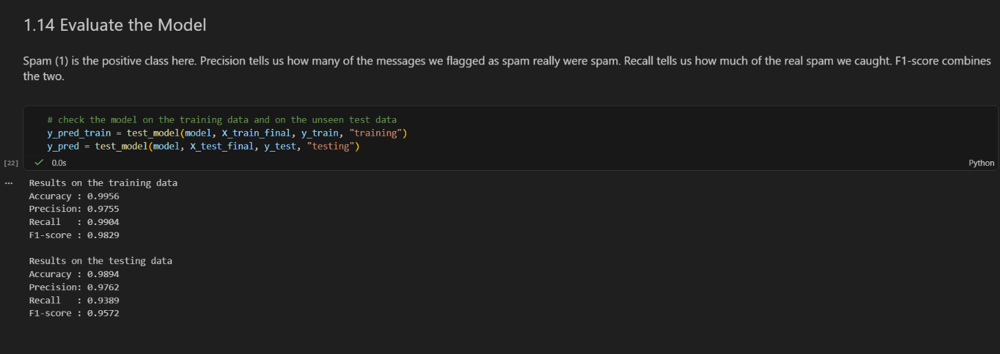

# SMS-Spam-Detection

Classifies SMS text messages as spam or ham (normal) from the words in the message and four simple numeric features, using logistic regression (pandas, matplotlib, seaborn, scikit-learn) in a Jupyter notebook.

 

**Course:** AI101: Data Science and AI Essentials with Python, School of AI and Data Engineering, IIT Ropar **Team no.:** 48

## Team and roles

| Member | Entry no. | GitHub handle | Role |
|---|---|---|---|
| Abhinav Singh | 2026EEB1315 | Obliterator-Abhinav | Execution Lead |
| Kusulure Sri Charan | 2026AIB1052 | K-SriCharan-7781 | Video Lead |
| Aadrish Deb | 2026MCB1503 | 2026mcb1503-pixel | PPT Lead |
| Sadhil Khandelwal | 2026EEB1404 | 2026eeb1404-stack | Documentation Lead |

*All four members contributed code (see commit history).*

## Problem and dataset

- **Problem:** SMS spam detection: decide whether a text message is an unwanted promotional or scam message (spam) or a normal message (ham), so that a filter can block spam without blocking real messages.
- **Task:** Binary classification with logistic regression, with `spam` (1) as the positive class and ham (0) as the other class.
- **Dataset:** SMS Spam Collection (UCI Machine Learning Repository, CC BY 4.0): https://archive.ics.uci.edu/dataset/228/sms+spam+collection
  Almeida, T. & Hidalgo, J. (2011). *SMS Spam Collection* [Dataset]. https://doi.org/10.24432/C5CC84
- **File used:** `data/sms_spam.csv` (the original tab-separated file converted to CSV)
- **Size:** 5,574 messages and 2 columns (no missing values). 403 duplicate messages are removed, which leaves 5,171 messages (4,518 ham and 653 spam).
- **Columns:**
  - Label: `label` (`ham` or `spam`)
  - Text: `message`
  - Features made in the notebook: `msg_len`, `digit_count`, `capital_ratio`, `exclaim_count`, and word counts of the 1,000 best words

## Approach

The notebook `SMS_Spam_Logistic_Regression.ipynb` runs these steps, one cell at a time:

1. Import libraries and load the dataset
2. Check the data (shape, missing values, duplicates, number of ham and spam messages)
3. Preprocess: remove duplicates, turn the label into 0 and 1, and create four numeric features (message length, digit count, capital-letter ratio, number of exclamation marks)
4. Explore: correlation of the numeric features with the label (heatmap)
5. Split 80% train and 20% test (`random_state=42`, stratified so both parts have the same share of spam)
6. Scale the numeric features (StandardScaler), count the words (CountVectorizer) and keep the best 1,000 words (chi-square), all fitted on the training data only
7. Train a logistic regression model with `class_weight="balanced"`, and plot the loss against the number of iterations
8. Evaluate with accuracy, precision, recall, F1-score and a confusion matrix
9. Show the features with the largest coefficients and the messages the model got wrong

## Project structure

```
sms-spam-detection/
├── data/
│   └── sms_spam.csv
├── figures/
│   ├── class_balance.png
│   ├── correlation_heatmap.png
│   ├── loss_curve.png
│   ├── confusion_matrix.png
│   └── top_coefficients.png
├── docs/
│   ├── expected_output.png
│   └── slides.pdf
├── SMS_Spam_Logistic_Regression.ipynb
├── requirements.txt
└── README.md
```

## Setup and how to run

Tested on Windows 11 with Python 3.13 (64-bit). The Mac and Linux commands below are the standard equivalents.

### What you need
- **Python 3.12 or 3.13 (64-bit).** Do not use Python 3.11 or older, and do not use 3.14 or newer. The libraries in `requirements.txt` do not install on those versions.
- **Git**, to download the project.
- About 1 GB of free disk space and an internet connection for the install.

Check your Python version first:

| System | Command |
|---|---|
| Windows | `py -0p` (lists all installed Pythons, look for 3.13 or 3.12) |
| Mac / Linux | `python3 --version` (or `python3.13 --version`) |

### Step 1: Download the project
Open a terminal (Windows: Command Prompt, `cmd`) inside the folder where you want the project by typing cmd in the address bar, then run:

```
git clone https://github.com/Obliterator-Abhinav/sms-spam-detection.git
cd sms-spam-detection
```

You should see `data`, `requirements.txt` and `SMS_Spam_Logistic_Regression.ipynb` in the folder.

### Step 2: Create a virtual environment
This keeps the project's libraries separate from everything else on the computer.
 
**Windows (Command Prompt):**
```
py -3.13 -m venv venv
```
```
venv\Scripts\activate
```
(Use `py -3.12` if you only have Python 3.12.)
 
**Mac / Linux:**
```
python3.13 -m venv venv
source venv/bin/activate
```
(Use `python3.12` if you only have Python 3.12.)
 
The line in the terminal should now start with `(venv)`. Check with `python --version`: it must show 3.13.x or 3.12.x.
 
> Windows PowerShell may say "running scripts is disabled" when you activate. Use Command Prompt (`cmd`) instead.
 
### Step 3: Install the libraries
```
pip install -r requirements.txt
```
If there is an error of 'Blocked by your organization' something like that, try
```
python -m pip install -r requirements.txt
```
This takes about 2 to 5 minutes. It must end with a line that starts with `Successfully installed`. If you see red text with `error`, see the table at the bottom.
 
### Step 4: Start Jupyter Notebook
```
jupyter notebook
```
A browser tab opens. If it does not, copy the `http://localhost:8888/...` address from the terminal into your browser. Leave the terminal window open while you use the notebook.
 
> **Not using a virtual environment, or `pip` / `jupyter` is not recognized?** On Windows, run the same commands through the Python launcher and name the version, so the right Python is used:
> ```
> py -3.13 -m pip install -r requirements.txt
> py -3.13 -m jupyter notebook
> ```
> (Use `-3.12` if that is the version you have.) On Mac / Linux use `python3.13 -m pip install -r requirements.txt` and `python3.13 -m jupyter notebook`. Always use Python 3.12 or 3.13, because other versions fail to install the libraries.

 
### Step 5: Run the notebook
1. Click `SMS_Spam_Logistic_Regression.ipynb`.
2. In the menu, click **Kernel → Restart & Run All** (in newer versions: **Run → Run All Cells**).
3. Wait until the last cell finishes. This takes about 10 seconds to 1 minute. A cell that is still running shows `[*]` next to it.

### Step 6: Check the result
There should be no red error boxes, and the main numbers should match:

| Item | Expected value |
|---|---|
| Dataset shape | (5574, 2) |
| Rows after removing duplicates | 5171 |
| Final training data shape | (4136, 1004) |
| Iterations used | 28 |
| Test accuracy | 0.9894 |
| Test precision (spam) | 0.9762 |
| Test recall (spam) | 0.9389 |
| Test F1-score (spam) | 0.9572 |

Plots appear for the class balance, correlation heatmap, loss curve, confusion matrix and top features.

### Stopping
Close the browser tab, then press `Ctrl+C` in the terminal and confirm with `y`. To leave the virtual environment, type `deactivate`.

---

### Option B: Run it in VS Code instead of the browser
Use this if the computer already has Visual Studio Code. Steps 1 to 3 are the same as above, so do them first (clone, create the virtual environment, install the libraries). Then:

1. **Install the extensions (one time).** In VS Code, click the Extensions icon on the left (four squares), then search for and install **Python** and **Jupyter** (both from Microsoft). If VS Code asks to install them when you open the notebook, click Install.
2. **Open the project folder.** Click **File → Open Folder** and choose the cloned project folder (the one that contains `data` and `requirements.txt`). Click "Yes, I trust the authors" if asked. Opening the folder matters: the notebook reads `data/sms_spam.csv`, which only works from the project folder.
3. **Open the notebook.** Click `SMS_Spam_Logistic_Regression.ipynb` in the file list.
4. **Select the right kernel.** Click **Select Kernel** at the top right of the notebook, then **Python Environments**, and choose the one named **venv** (its path ends with `venv\Scripts\python.exe` on Windows or `venv/bin/python` on Mac/Linux). It must show Python 3.13 or 3.12. If `venv` is not in the list, click the refresh icon, or close and reopen VS Code and try again.
5. **Run everything.** Click **Run All** at the top of the notebook and wait until every cell finishes (about 10 seconds to 1 minute).
6. **Check the result** with the table in Step 6 above. There should be no red errors.

If VS Code shows `ModuleNotFoundError`, the wrong kernel is selected. Repeat step 4 and choose `venv`. If it says the Jupyter kernel `ipykernel` is missing, open a terminal inside VS Code (**Terminal → New Terminal**), make sure the line starts with `(venv)`, and run `pip install -r requirements.txt` again.

### If something goes wrong

| What you see | Cause | Fix |
|---|---|---|
| `git is not recognized` | Git is not installed, or the terminal was opened before installing it | Install Git from git-scm.com, then open a new terminal |
| `py is not recognized` or `python3: command not found` | Python is not installed | Install Python 3.13 (64-bit) from python.org and tick "Add Python to PATH" |
| `No matching distribution found` or `Could not find vswhere.exe` or a long build error during `pip install` | Python is too old (3.11 or older) or too new (3.14 or newer) | Install Python 3.13, then repeat Step 2 and Step 3 |
| `ModuleNotFoundError` in the notebook | The `(venv)` was not active, or Step 3 did not finish | Activate the environment (Step 2), run `pip install -r requirements.txt` again, then restart Jupyter |
| `jupyter is not recognized` | The `(venv)` is not active | Repeat the activate command from Step 2 |
| `FileNotFoundError: data/sms_spam.csv` | Jupyter was started outside the project folder, or `data/` is missing | Close Jupyter, `cd` into the project folder, and run `jupyter notebook` again |
| Notebook shows old or empty output | The cells were not run | Click Kernel → Restart & Run All |

## Expected output

After **Run All Cells**, the evaluation cell prints:



```
Results on the testing data
Accuracy : 0.9894
Precision: 0.9762
Recall   : 0.9389
F1-score : 0.9572

              precision    recall  f1-score   support

         Ham       0.99      1.00      0.99       904
        Spam       0.98      0.94      0.96       131

    accuracy                           0.99      1035
   macro avg       0.98      0.97      0.98      1035
weighted avg       0.99      0.99      0.99      1035
```

The notebook also shows five plots (class balance, correlation heatmap, loss curve, confusion matrix and top coefficients). Copies of them are saved in `figures/`.

## Results

| Metric (test set, 1,035 messages, 131 of them spam) | Value |
|---|---|
| Accuracy | 0.9894 |
| Precision (spam) | 0.9762 |
| Recall (spam) | 0.9389 |
| F1-score (spam) | 0.9572 |

- The confusion matrix on the test set is TN = 901, FP = 3, FN = 8 and TP = 123. The model flagged 126 messages as spam, and 123 of them were really spam. It found 123 of the 131 real spam messages and missed 8.
- Accuracy alone is misleading here, because always predicting "ham" already gives about 87%. That is why precision, recall and F1-score for the spam class are reported.
- `digit_count` has the largest coefficient (spam messages have about 15 digits on average, ham about 0.3). Promo words such as `text`, `notice`, `mobile` and `ringtone` push a message towards spam, and everyday words such as `my`, `at`, `hope` and `hey` push it towards ham.
- Training F1 (0.983) is a little higher than test F1 (0.957), so there is a small amount of overfitting.
- Limitation: the data is from around 2011 and is in English, so spam in India today (bank and OTP scams, Hinglish, short links) looks different and the model would probably do worse on it. We did not test this.
- RMSE is not reported, because it is a regression metric and this is a classification problem.

## Links

- Slides (5 slides): [Read PDF](docs/slides.pdf)
- Video (max 7 min): 

## AI-use disclosure

- Claude (Anthropic): used by us to write the first version of the notebook code, to draft the README and `requirements.txt`, to guide us through Github, and to help us fix errors. We read, ran and checked all of it, and every member can explain the code.
- No AI was used to generate the dataset or the results. The numbers come from running the notebook on the dataset.
